<p align="center">
  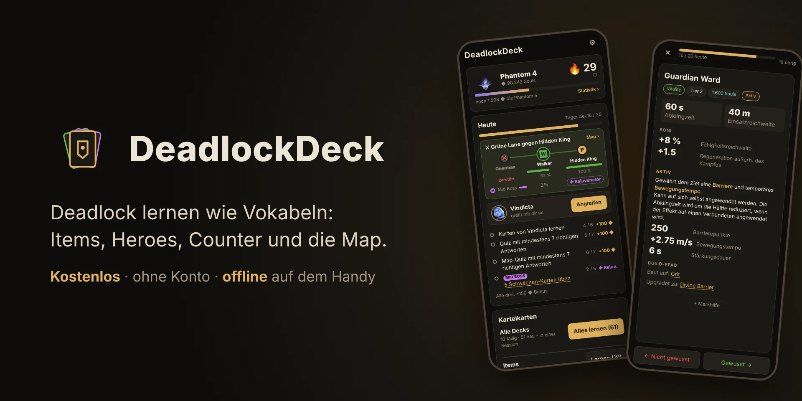
</p>

<p align="center">
  <a href="https://blaxx01.github.io/DeadlockDeck/">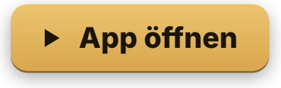</a>
</p>

<p align="center">
  Karteikarten-App fürs Handy, mit der du <b>Deadlock</b> lernst wie Vokabeln: was jedes Item kostet und kann, welche
  Fähigkeiten ein Hero hat, was gegen ihn hilft und wo auf der Map was ist.<br>
  Kostenlos, ohne Konto, auf Deutsch – und nach dem ersten Start auch offline.
</p>

## Karteikarten

<p align="center">
  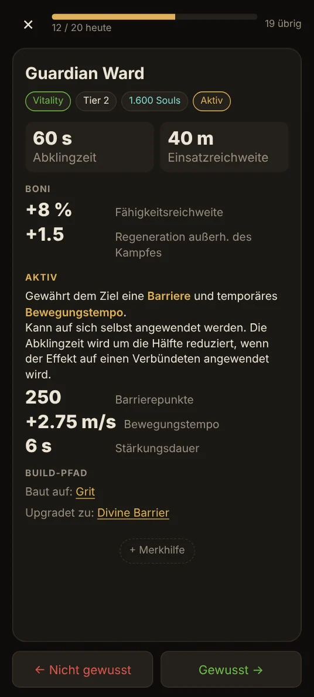
  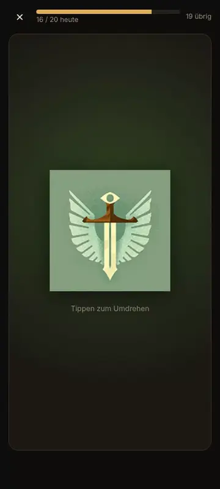
  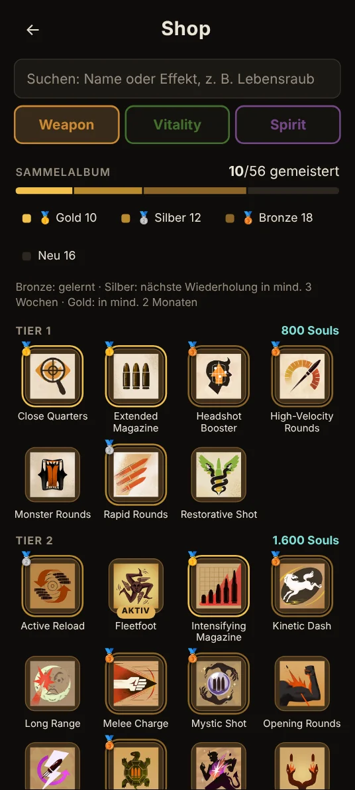
</p>

- **Vier Decks:** Items, Fähigkeiten, Heroes und Counter (die 3 Items, die Spieler gegen einen Hero am deutlichsten
  öfter kaufen – aus der Statistik der Community-API)
- **Antippen** dreht die Karte um, nach **rechts wischen** heißt gewusst, nach **links** nicht gewusst. Das Lernsystem
  (FSRS) holt jede Karte wieder, kurz bevor du sie vergessen würdest
- Neue Karten lernst du erst **kennen**, die Abfrage kommt ein paar Karten später
- **Merkhilfen** auf der Rückseite, Rückrichtung (Name → Bild) und Antwort eintippen
- Der **Shop** ist Nachschlagewerk und **Sammelalbum** zugleich: Bronze, Silber, Gold – je nachdem, wie fest eine
  Karte sitzt

## Spielmodi

<p align="center">
  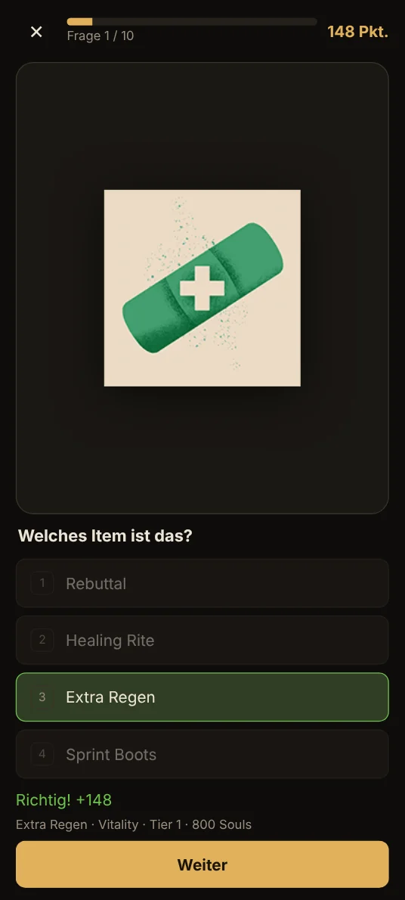
  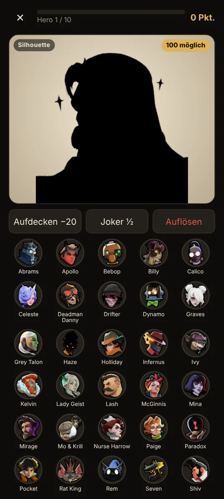
  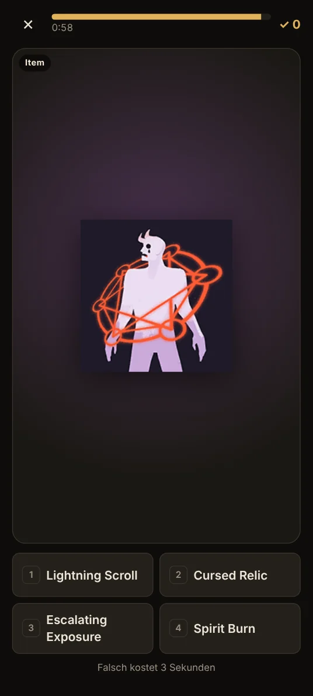
</p>

- **Quiz** in Runden à 10 Fragen: Bild → Name, Effekt → Item, Kosten und Abklingzeiten, Build-Pfad, Counter,
  Fähigkeiten-Upgrades
- **Hero erraten** an Silhouette, Ausschnitt, unscharfem Bild oder einer Fähigkeit – mit Aufdecken und Joker
- **60-Sekunden-Sprint**, **Überleben** mit 3 Leben und das **Build-Quiz** (alle Items eines Hero-Builds benennen)
- Gefragt wird zuerst, was du schon gelernt hast; Fehler sammelt **Schwächen üben** für gezieltes Training

## Map

<p align="center">
  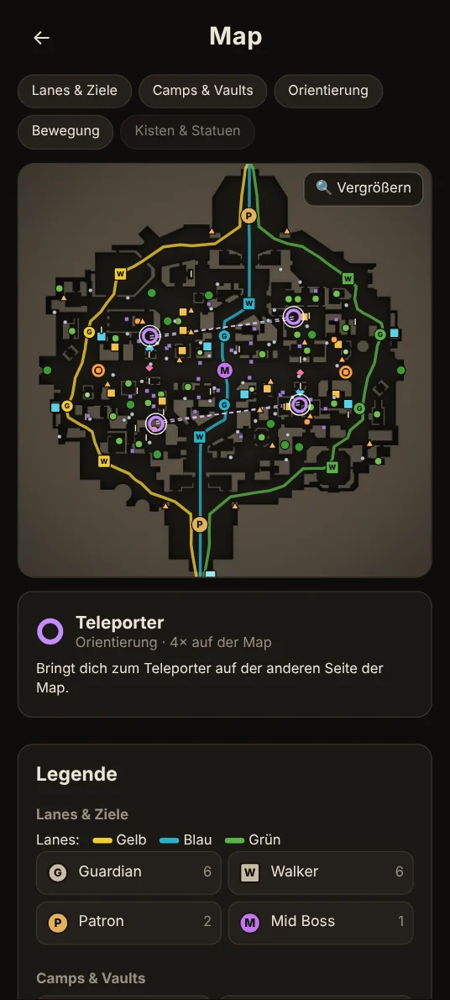
  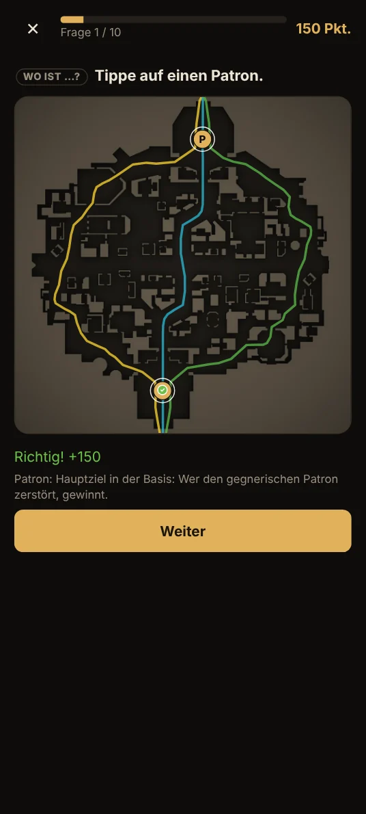
  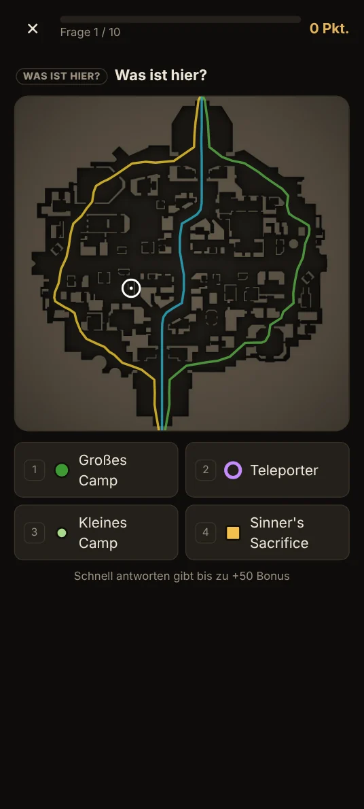
</p>

- Die **Map** zum Nachschlagen: Lanes, Guardians, Walker, Patron, Camps, Shops, Teleporter, Urne und mehr – in Ebenen,
  antippen zeigt, was es ist
- **Map-Quiz:** „Wo ist …?“ – auf die Map tippen – und „Was ist hier?“ mit vier Antworten

## Fortschritt

<p align="center">
  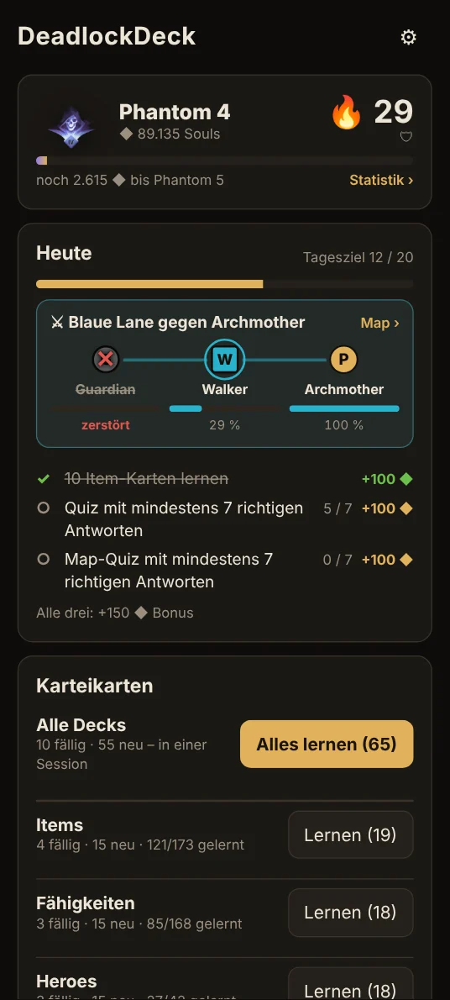
  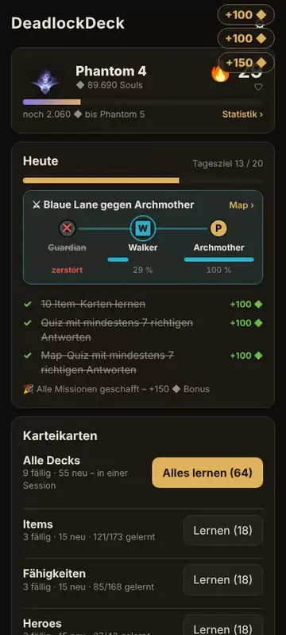
  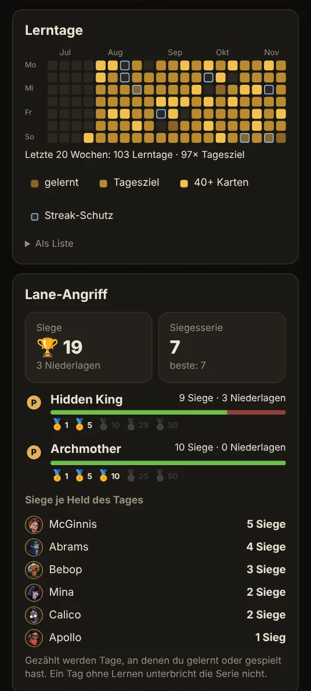
</p>

- **Souls und Rang** mit den echten Deadlock-Abzeichen, dazu ein **Streak** mit Streak-Schutz
- **3 Tagesmissionen als Lane-Angriff:** Mit deinem **Helden des Tages** greifst du eine Lane an – jeder Fortschritt
  macht Schaden, Guardian, Walker und am Ende der Patron (Hidden King oder Archmother) fallen. Dazu der **Mid Boss**
  (Schwächen-Training) mit dem Rejuvenator, Revanche nach einer Niederlage, Serien-Bonus und Trophäen
- **Missionen wachsen mit deinem Rang:** am Anfang leichte Ziele, Sprint und Hero erraten ab Kultist, Build-Quiz ab
  Akolyth – passt eine Lane gar nicht, lässt sie sich einmal am Tag gegen Souls tauschen (teuer)
- **Statistik** mit Kalender der Lerntage, Siegen und Niederlagen und Souls-Verlauf; **Hero-Meisterschaft** mit bis zu
  5 Sternen je Hero

Alle Funktionen und Entscheidungen im Detail: [SPEC.md](SPEC.md)

## Aufs Handy

1. **[App öffnen](https://blaxx01.github.io/DeadlockDeck/)** im Handy-Browser
2. **Android/Chrome:** Menü → „App installieren“ bzw. „Zum Startbildschirm hinzufügen“<br>
   **iPhone/Safari:** Teilen → „Zum Home-Bildschirm“
3. Einmal mit Internet öffnen – die App lädt alle Daten und Bilder, danach geht alles offline

Dein **Fortschritt bleibt auf dem Gerät** – kein Konto, keine Anmeldung. Unter ⚙ → *Backup* sicherst du ihn (auf dem
Handy übers Teilen-Menü, z. B. in Drive) und spielst ihn auf einem neuen Gerät wieder ein; die Startseite erinnert
alle zwei Wochen daran. Nach einem **Spiel-Patch** erkennt die App geänderte Karten und zeigt „vorher → nachher“.

## Entwicklung

React und TypeScript mit Vite, IndexedDB über Dexie, Lernsystem FSRS (ts-fsrs), PWA mit vite-plugin-pwa.

```bash
npm install
npm run dev          # Dev-Server
npm test             # Unit-Tests (Vitest)
npm run lint         # oxlint
npm run build        # Produktions-Build nach dist/
npm run screenshots  # Bilder dieser README neu erzeugen (docs/readme/)
```

`npm run screenshots` baut die App, lädt echte Daten aus der API, spielt einen erfundenen Lernstand ein und nimmt
Screenshots und Animationen auf. Dafür braucht es Chromium für Playwright (einmalig `npx playwright install chromium`)
und ffmpeg.

<details>
<summary><b>Aufbau</b> – welche Datei was macht</summary>

| Pfad | Inhalt |
|---|---|
| `src/data/normalize.ts` | API-Items → Karteikarten (englische Namen, deutsche Texte) |
| `src/data/heroes.ts` | API-Heroes + Abilities → Hero- und Fähigkeiten-Karten |
| `src/decks.ts` | Die vier Decks, Neu-Limit je Deck |
| `src/guess/guess.ts`, `src/views/Guess.tsx` | Hero erraten: Runden, Aufdeck-Stufen, Joker, Punkte |
| `src/data/fingerprint.ts`, `src/data/patches.ts` | Patch-Erkennung: Fingerprints der Spielwerte, Vergleich, „vorher → nachher“ |
| `src/data/counters.ts`, `src/data/counterSync.ts` | Counter: Kauf-Faktor aus der API-Statistik, Top 3, wöchentliches Laden, Wechsel des Top-Counters |
| `src/data/builds.ts`, `src/data/buildSync.ts` | Builds: typischer Build (meistgekauft, nach Kaufzeit) und meistgespielter Community-Build, wöchentlich |
| `src/builds/buildQuiz.ts`, `src/views/BuildQuiz.tsx` | Build-Quiz: Runde Icon für Icon, Extra-Namen, Fehler, Bestwerte |
| `src/sprint/sprint.ts`, `src/views/Sprint.tsx` | 60-Sekunden-Sprint: Fragen je Sorte, Uhr mit −3 s und Pause, Highscore je Auswahl |
| `src/survival/survival.ts`, `src/views/Survival.tsx` | Überleben: Leben, Zeit je Frage (Ablauf als Reducer), Fragen-Pakete |
| `src/game/souls.ts`, `src/game/ranks.ts` | Souls-Konto (Verlauf, Rundenregel, Verfall, rückwirkende Gutschrift) und Rangstufen |
| `src/game/missions.ts`, `src/game/missionLevels.ts` | Tagesmissionen, Tagesziel-Bonus, Missions-Stufen nach Rang, Lane tauschen |
| `src/game/laneAttack.ts`, `src/components/LaneBar.tsx`, `src/views/LaneView.tsx` | Lane-Angriff: Lane und Gegner des Tages, Leben der Ziele (Gesamtfortschritt), Einblendungen, Bilanz mit Revanche, Rejuvenator, Trophäen; Leiste auf der Startseite und Lane-Map |
| `src/game/dayHero.ts`, `src/components/HeroOfDay.tsx`, `src/views/HeroLearn.tsx` | Held des Tages: Vorschläge, Hero-Mission (lernen, Build-Quiz, wiederholen), Wahl auf der Startseite, Session mit seinen Karten |
| `src/game/weakness.ts`, `src/views/Weakness.tsx` | Schwächen: Fehler aus allen Modi, hartnäckige Karten, Rangfolge, Training |
| `src/game/notes.ts`, `src/components/Notes.tsx` | Merkhilfen: speichern, auf der Kartenrückseite zeigen, bearbeiten |
| `src/game/mastery.ts`, `src/game/heroMastery.ts` | Stufe einer Karte (Bronze/Silber/Gold), Sterne je Hero |
| `src/game/milestones.ts` | Meilenstein-Souls (Silber, Gold, Hero-Sterne), nachträgliches Gutschreiben |
| `src/game/stats.ts`, `src/views/Stats.tsx` | Statistik: Kalender der Lerntage, Souls-Verlauf, Karten je Deck |
| `src/views/Heroes.tsx` | Hero-Meisterschaft: Raster mit Sternen, Hero-Seite |
| `src/components/SoulsFx.tsx` | „+10 ◆“-Animation (auch „⚔ Guardian −10 %“) und Aufstieg mit Konfetti |
| `src/data/sync.ts` | Laden von der API, Bilder für offline vorladen |
| `src/data/db.ts` | IndexedDB (Dexie): Karten, Fortschritt, Tagesstatistik, Einstellungen |
| `src/data/backup.ts`, `src/data/persist.ts` | Backup: Export (Teilen/Download), Import, Erinnerung; dauerhafter Speicher |
| `src/map/mapData.ts`, `src/data/mapSync.ts` | Map: API-Daten → Objekte je Art, Lanes aus den Ziplines, Namen und Erklärungen; Laden und Speichern |
| `src/map/mapQuiz.ts`, `src/views/MapQuiz.tsx` | Map-Quiz: „Wo ist …?“ (Tippen mit Toleranz), „Was ist hier?“, Runden |
| `src/components/MapCanvas.tsx`, `src/views/MapView.tsx` | Map-Darstellung (Minimap, Lanes, Symbole, Zoom) und Map-Seite mit Ebenen und Legende |
| `src/srs/srs.ts` | Lernlogik: Warteschlange (inkl. Rückrichtung), FSRS-Bewertung, Streak |
| `src/srs/typing.ts`, `src/components/AnswerInput.tsx` | Antwort eintippen: tolerante Prüfung, Eingabe, Ergebnis |
| `src/components/ReverseCards.tsx` | Rückrichtung: Vorderseite mit Name, Bild auf der Rückseite |
| `src/quiz/quiz.ts` | Quiz: Fragetypen, ähnliche falsche Antworten, Runden (Gelerntes zuerst / nur / alles), Punkte |
| `src/quiz/load.ts` | Zusatzdaten für Quiz und Überleben, gelernte Karten (für „Gefragt wird“) |
| `src/quiz/upgrades.ts`, `src/quiz/effects.ts` | Upgrade-Fragen (gelernte Fähigkeiten bevorzugt) und Item-Effekt-Fragen |
| `src/data/popularity.ts` | Neue Item-Karten nach Beliebtheit (Käufe aus der Counter-Statistik) |
| `src/views/Quiz.tsx`, `src/components/QuizParts.tsx` | Quiz-Ansicht mit Auflösung und Ergebnis; Fragen-Bausteine (auch für Überleben) |
| `src/views/Shop.tsx`, `src/views/ItemDetail.tsx` | Shop (Tabs, Tiers, Suche, Sammelalbum) und Item-Detailseite |
| `src/shop/search.ts` | Shop-Aufbau und Suche (Name + Effekttext) |
| `src/nav.ts` | Navigation über den Browser-Verlauf (Zurück-Geste) |
| `src/components/FlashCard.tsx` | Karte mit Umdrehen + Swipe |
| `scripts/screenshots.mjs` | Bilder dieser README: Demo-Stand, Screenshots, Animationen, Banner |

</details>

<details>
<summary><b>Deploy</b> auf GitHub Pages</summary>

Der Workflow `.github/workflows/deploy.yml` baut und veröffentlicht bei jedem Push auf `main`
(oder manuell unter *Actions → Deploy to GitHub Pages → Run workflow*). Einmalig einrichten:

1. Repo auf **öffentlich** stellen (GitHub Pages braucht das bei Free-Accounts)
2. *Settings → Pages → Source:* **GitHub Actions**
3. `main` als Standard-Branch

</details>

## Daten & Rechtliches

Item-Daten, Bilder, Map, Counter-Statistik und Builds kommen von der Community-API
[deadlock-api.com](https://deadlock-api.com). Inoffizielles Fan-Projekt, nicht mit Valve verbunden;
Deadlock und alle Spielbilder © Valve.
